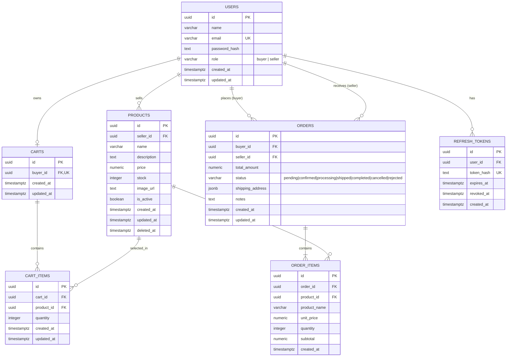
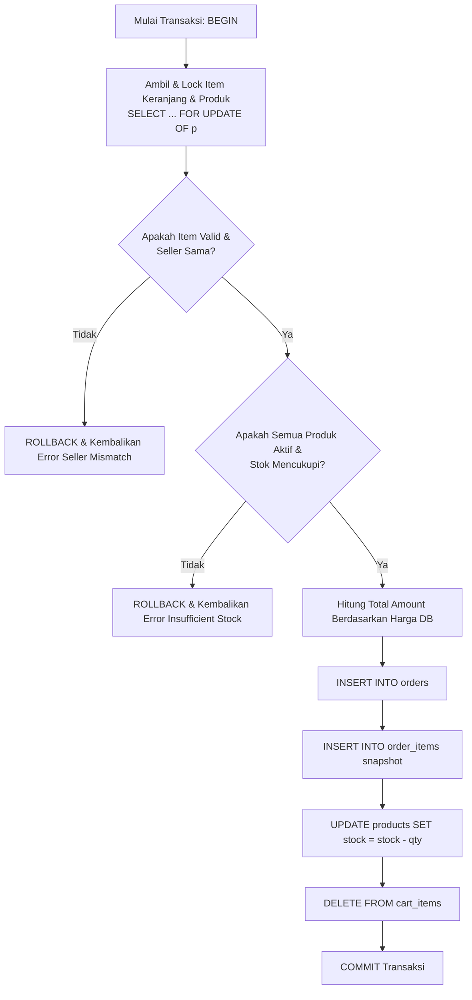

# Database Architecture & Entity Relationship Diagram (ERD)

**Database Engine:** PostgreSQL (v15+)  
**Data Integrity:** Foreign Key Constraints, Check Constraints, Row Locking, ACID Transactions  
**Primary Key Convention:** UUIDv4 (`gen_random_uuid()`)  
**Timestamp Standard:** `TIMESTAMPTZ` dalam format UTC  

---

## 1. Overview & Architectural Principles

1. **UUID as Primary Key:** Seluruh tabel menggunakan tipe `UUID` dengan default generator `gen_random_uuid()` untuk menghindari *sequential ID enumeration* dan memudahkan migrasi data multi-environment.
2. **Snapshot Historical Integrity:** Tabel detail transaksi (`order_items`) menyimpan salinan nilai harga satuan (`unit_price`) dan nama produk (`product_name`) saat checkout dilakukan. Perubahan data katalog di masa mendatang tidak akan merubah nilai historis transaksi yang sudah tercatat.
3. **Soft Delete on Products:** Produk yang dihapus oleh penjual hanya ditandai dengan mengisi `deleted_at = NOW()`. Baris data tidak dihapus secara fisik (`DELETE`) agar tidak merusak relasi foreign key dari transaksi yang pernah terjadi.
4. **Strict Concurrency Control:** Pengurangan stok saat checkout dan pemulihan stok saat pembatalan wajib dibungkus dalam PostgreSQL Transaction dengan row lock (`SELECT ... FOR UPDATE`).
5. **Auditing Timestamps:** Setiap tabel dilengkapi kolom `created_at` dan `updated_at` dengan zona waktu UTC (`TIMESTAMPTZ`).

---

## 2. Entity Relationship Diagram (ERD)



---

## 3. Detail Spesifikasi Tabel

### 3.1 `users`
Menyimpan data identitas pengguna akun sistem (pembeli maupun penjual).

| Kolom | Tipe Data | Constraint | Keterangan |
|---|---|---|---|
| `id` | `UUID` | `PRIMARY KEY DEFAULT gen_random_uuid()` | Pengenal unik pengguna |
| `name` | `VARCHAR(100)` | `NOT NULL` | Nama lengkap / tampilan |
| `email` | `VARCHAR(255)` | `NOT NULL` | Email unik (login identifier) |
| `password_hash` | `TEXT` | `NOT NULL` | Hasil hash password (Argon2id / Bcrypt) |
| `role` | `VARCHAR(20)` | `NOT NULL CHECK (role IN ('buyer', 'seller'))` | Peran hak akses |
| `created_at` | `TIMESTAMPTZ` | `NOT NULL DEFAULT NOW()` | Waktu pembuatan akun |
| `updated_at` | `TIMESTAMPTZ` | `NOT NULL DEFAULT NOW()` | Waktu modifikasi terakhir |

*Index Tambahan:* `CREATE UNIQUE INDEX idx_users_email_lower ON users (LOWER(email));`

---

### 3.2 `products`
Menyimpan data produk yang ditawarkan oleh penjual.

| Kolom | Tipe Data | Constraint | Keterangan |
|---|---|---|---|
| `id` | `UUID` | `PRIMARY KEY DEFAULT gen_random_uuid()` | Pengenal unik produk |
| `seller_id` | `UUID` | `NOT NULL REFERENCES users(id) ON DELETE RESTRICT` | Relasi ke seller pemilik produk |
| `name` | `VARCHAR(150)` | `NOT NULL` | Nama barang |
| `description` | `TEXT` | `NULL` | Deskripsi lengkap produk |
| `price` | `NUMERIC(14,2)` | `NOT NULL CHECK (price >= 0)` | Harga jual satuan |
| `stock` | `INTEGER` | `NOT NULL DEFAULT 0 CHECK (stock >= 0)` | Sisa stok barang fisik |
| `image_url` | `TEXT` | `NULL` | Tautan gambar produk |
| `is_active` | `BOOLEAN` | `NOT NULL DEFAULT TRUE` | Status aktif/nonaktif dari seller |
| `created_at` | `TIMESTAMPTZ` | `NOT NULL DEFAULT NOW()` | Waktu ditambahkan |
| `updated_at` | `TIMESTAMPTZ` | `NOT NULL DEFAULT NOW()` | Waktu diperbarui |
| `deleted_at` | `TIMESTAMPTZ` | `NULL` | Waktu soft-delete |

---

### 3.3 `carts`
Menyimpan keranjang belanja aktif pembeli (1 buyer memiliki maksimal 1 record cart).

| Kolom | Tipe Data | Constraint | Keterangan |
|---|---|---|---|
| `id` | `UUID` | `PRIMARY KEY DEFAULT gen_random_uuid()` | ID keranjang |
| `buyer_id` | `UUID` | `NOT NULL UNIQUE REFERENCES users(id) ON DELETE RESTRICT` | Pemilik keranjang |
| `created_at` | `TIMESTAMPTZ` | `NOT NULL DEFAULT NOW()` | Waktu dibuat |
| `updated_at` | `TIMESTAMPTZ` | `NOT NULL DEFAULT NOW()` | Waktu perubahan |

---

### 3.4 `cart_items`
Menyimpan produk dan kuantitas yang ada di dalam keranjang belanja.

| Kolom | Tipe Data | Constraint | Keterangan |
|---|---|---|---|
| `id` | `UUID` | `PRIMARY KEY DEFAULT gen_random_uuid()` | ID baris item |
| `cart_id` | `UUID` | `NOT NULL REFERENCES carts(id) ON DELETE CASCADE` | Keranjang yang bersangkutan |
| `product_id` | `UUID` | `NOT NULL REFERENCES products(id) ON DELETE RESTRICT` | Produk yang dipilih |
| `quantity` | `INTEGER` | `NOT NULL CHECK (quantity > 0)` | Kuantitas yang diinginkan |
| `created_at` | `TIMESTAMPTZ` | `NOT NULL DEFAULT NOW()` | Waktu ditambahkan |
| `updated_at` | `TIMESTAMPTZ` | `NOT NULL DEFAULT NOW()` | Waktu kuantitas diubah |

*Unique Constraint:* `CONSTRAINT uq_cart_product UNIQUE(cart_id, product_id)`

---

### 3.5 `orders`
Menyimpan ringkasan transaksi pesanan hasil checkout pembeli.

| Kolom | Tipe Data | Constraint | Keterangan |
|---|---|---|---|
| `id` | `UUID` | `PRIMARY KEY DEFAULT gen_random_uuid()` | Kode unik pesanan |
| `buyer_id` | `UUID` | `NOT NULL REFERENCES users(id) ON DELETE RESTRICT` | Pembeli |
| `seller_id` | `UUID` | `NOT NULL REFERENCES users(id) ON DELETE RESTRICT` | Penjual (single seller) |
| `total_amount` | `NUMERIC(14,2)` | `NOT NULL CHECK (total_amount >= 0)` | Total nilai pesanan |
| `status` | `VARCHAR(20)` | `NOT NULL DEFAULT 'pending' CHECK (...)` | Status lifecycle pesanan |
| `shipping_address` | `JSONB` | `NOT NULL` | Alamat pengiriman terstruktur |
| `notes` | `TEXT` | `NULL` | Catatan pembeli |
| `created_at` | `TIMESTAMPTZ` | `NOT NULL DEFAULT NOW()` | Waktu pemesanan |
| `updated_at` | `TIMESTAMPTZ` | `NOT NULL DEFAULT NOW()` | Waktu modifikasi status |

**Nilai ENUM Status:**
- `pending`: Menunggu konfirmasi penjual (stok sudah terpotong).
- `confirmed`: Pesanan disetujui penjual.
- `processing`: Pesanan sedang dikemas / dipersiapkan.
- `shipped`: Pesanan diserahkan ke jasa pengiriman.
- `completed`: Pesanan telah diterima pembeli.
- `cancelled`: Pesanan dibatalkan pembeli saat masih pending (stok dipulihkan).
- `rejected`: Pesanan ditolak penjual (stok dipulihkan).

**Struktur JSONB `shipping_address`:**
```json
{
  "recipient_name": "Naabil Fikry",
  "phone": "081234567890",
  "address": "Jl. Telekomunikasi No. 1",
  "city": "Bandung",
  "province": "Jawa Barat",
  "postal_code": "40257"
}
```

---

### 3.6 `order_items`
Menyimpan snapshot detail barang pada saat pesanan tercipta.

| Kolom | Tipe Data | Constraint | Keterangan |
|---|---|---|---|
| `id` | `UUID` | `PRIMARY KEY DEFAULT gen_random_uuid()` | ID baris |
| `order_id` | `UUID` | `NOT NULL REFERENCES orders(id) ON DELETE RESTRICT` | Pesanan induk |
| `product_id` | `UUID` | `NOT NULL REFERENCES products(id) ON DELETE RESTRICT` | Referensi ke produk asal |
| `product_name` | `VARCHAR(150)` | `NOT NULL` | **Snapshot:** Nama produk saat dibeli |
| `unit_price` | `NUMERIC(14,2)` | `NOT NULL CHECK (unit_price >= 0)` | **Snapshot:** Harga per satuan saat dibeli |
| `quantity` | `INTEGER` | `NOT NULL CHECK (quantity > 0)` | Jumlah yang dipesan |
| `subtotal` | `NUMERIC(14,2)` | `NOT NULL CHECK (subtotal >= 0)` | `unit_price * quantity` |
| `created_at` | `TIMESTAMPTZ` | `NOT NULL DEFAULT NOW()` | Waktu pencatatan |

*Check Constraint:* `CONSTRAINT chk_order_item_subtotal CHECK (subtotal = unit_price * quantity)`

---

### 3.7 `refresh_tokens`
Menyimpan hash refresh token untuk mendukung session rotation & revocation.

| Kolom | Tipe Data | Constraint | Keterangan |
|---|---|---|---|
| `id` | `UUID` | `PRIMARY KEY DEFAULT gen_random_uuid()` | ID sesi token |
| `user_id` | `UUID` | `NOT NULL REFERENCES users(id) ON DELETE CASCADE` | Pemilik sesi |
| `token_hash` | `TEXT` | `NOT NULL UNIQUE` | Hash SHA-256 dari refresh token |
| `expires_at` | `TIMESTAMPTZ` | `NOT NULL` | Masa kadaluarsa token |
| `revoked_at` | `TIMESTAMPTZ` | `NULL` | Waktu pencabutan token (logout) |
| `created_at` | `TIMESTAMPTZ` | `NOT NULL DEFAULT NOW()` | Waktu penerbitan |

---

## 4. PostgreSQL DDL Migrations

Simpan file ini pada `apps/backend-service/migrations/000001_init_schema.up.sql`:

```sql
-- ========================================================
-- SIMPLE E-COMMERCE DATABASE SCHEMA (PostgreSQL)
-- File: apps/backend-service/migrations/000001_init_schema.up.sql
-- ========================================================

-- Pastikan extension pgcrypto/uuid tersedia jika diperlukan
CREATE EXTENSION IF NOT EXISTS "pgcrypto";

-- 1. USERS
CREATE TABLE users (
    id UUID PRIMARY KEY DEFAULT gen_random_uuid(),
    name VARCHAR(100) NOT NULL,
    email VARCHAR(255) NOT NULL,
    password_hash TEXT NOT NULL,
    role VARCHAR(20) NOT NULL CHECK (role IN ('buyer', 'seller')),
    created_at TIMESTAMPTZ NOT NULL DEFAULT NOW(),
    updated_at TIMESTAMPTZ NOT NULL DEFAULT NOW()
);

CREATE UNIQUE INDEX idx_users_email_lower ON users (LOWER(email));

-- 2. PRODUCTS
CREATE TABLE products (
    id UUID PRIMARY KEY DEFAULT gen_random_uuid(),
    seller_id UUID NOT NULL REFERENCES users(id) ON DELETE RESTRICT,
    name VARCHAR(150) NOT NULL,
    description TEXT,
    price NUMERIC(14,2) NOT NULL CHECK (price >= 0),
    stock INTEGER NOT NULL DEFAULT 0 CHECK (stock >= 0),
    image_url TEXT,
    is_active BOOLEAN NOT NULL DEFAULT TRUE,
    created_at TIMESTAMPTZ NOT NULL DEFAULT NOW(),
    updated_at TIMESTAMPTZ NOT NULL DEFAULT NOW(),
    deleted_at TIMESTAMPTZ
);

CREATE INDEX idx_products_seller ON products(seller_id);
CREATE INDEX idx_products_catalog ON products(is_active, created_at DESC) WHERE deleted_at IS NULL;

-- 3. CARTS
CREATE TABLE carts (
    id UUID PRIMARY KEY DEFAULT gen_random_uuid(),
    buyer_id UUID NOT NULL UNIQUE REFERENCES users(id) ON DELETE RESTRICT,
    created_at TIMESTAMPTZ NOT NULL DEFAULT NOW(),
    updated_at TIMESTAMPTZ NOT NULL DEFAULT NOW()
);

-- 4. CART ITEMS
CREATE TABLE cart_items (
    id UUID PRIMARY KEY DEFAULT gen_random_uuid(),
    cart_id UUID NOT NULL REFERENCES carts(id) ON DELETE CASCADE,
    product_id UUID NOT NULL REFERENCES products(id) ON DELETE RESTRICT,
    quantity INTEGER NOT NULL CHECK (quantity > 0),
    created_at TIMESTAMPTZ NOT NULL DEFAULT NOW(),
    updated_at TIMESTAMPTZ NOT NULL DEFAULT NOW(),
    CONSTRAINT uq_cart_product UNIQUE(cart_id, product_id)
);

CREATE INDEX idx_cart_items_cart ON cart_items(cart_id);

-- 5. ORDERS
CREATE TABLE orders (
    id UUID PRIMARY KEY DEFAULT gen_random_uuid(),
    buyer_id UUID NOT NULL REFERENCES users(id) ON DELETE RESTRICT,
    seller_id UUID NOT NULL REFERENCES users(id) ON DELETE RESTRICT,
    total_amount NUMERIC(14,2) NOT NULL CHECK (total_amount >= 0),
    status VARCHAR(20) NOT NULL DEFAULT 'pending' CHECK (
        status IN (
            'pending',
            'confirmed',
            'processing',
            'shipped',
            'completed',
            'cancelled',
            'rejected'
        )
    ),
    shipping_address JSONB NOT NULL,
    notes TEXT,
    created_at TIMESTAMPTZ NOT NULL DEFAULT NOW(),
    updated_at TIMESTAMPTZ NOT NULL DEFAULT NOW()
);

CREATE INDEX idx_orders_buyer ON orders(buyer_id, created_at DESC);
CREATE INDEX idx_orders_seller ON orders(seller_id, created_at DESC);
CREATE INDEX idx_orders_status ON orders(status);

-- 6. ORDER ITEMS
CREATE TABLE order_items (
    id UUID PRIMARY KEY DEFAULT gen_random_uuid(),
    order_id UUID NOT NULL REFERENCES orders(id) ON DELETE RESTRICT,
    product_id UUID NOT NULL REFERENCES products(id) ON DELETE RESTRICT,
    product_name VARCHAR(150) NOT NULL,
    unit_price NUMERIC(14,2) NOT NULL CHECK (unit_price >= 0),
    quantity INTEGER NOT NULL CHECK (quantity > 0),
    subtotal NUMERIC(14,2) NOT NULL CHECK (subtotal >= 0),
    created_at TIMESTAMPTZ NOT NULL DEFAULT NOW(),
    CONSTRAINT chk_order_item_subtotal CHECK (subtotal = unit_price * quantity)
);

CREATE INDEX idx_order_items_order ON order_items(order_id);
CREATE INDEX idx_order_items_product ON order_items(product_id);

-- 7. REFRESH TOKENS
CREATE TABLE refresh_tokens (
    id UUID PRIMARY KEY DEFAULT gen_random_uuid(),
    user_id UUID NOT NULL REFERENCES users(id) ON DELETE CASCADE,
    token_hash TEXT NOT NULL UNIQUE,
    expires_at TIMESTAMPTZ NOT NULL,
    revoked_at TIMESTAMPTZ,
    created_at TIMESTAMPTZ NOT NULL DEFAULT NOW()
);

CREATE INDEX idx_refresh_tokens_user ON refresh_tokens(user_id);
```

Untuk rollback schema (`000001_init_schema.down.sql`):
```sql
DROP TABLE IF EXISTS refresh_tokens CASCADE;
DROP TABLE IF EXISTS order_items CASCADE;
DROP TABLE IF EXISTS orders CASCADE;
DROP TABLE IF EXISTS cart_items CASCADE;
DROP TABLE IF EXISTS carts CASCADE;
DROP TABLE IF EXISTS products CASCADE;
DROP TABLE IF EXISTS users CASCADE;
```

---

## 5. Critical Database Transactions

### 5.1 Checkout Atomicity & Row Locking
Prosedur checkout wajib dijalankan di dalam satu `BEGIN ... COMMIT` block. Diagram alur operasional:



**Eksekusi SQL Idiomatik di Backend:**
```sql
BEGIN;

-- 1. Kunci baris produk yang dibeli agar stok tidak bisa dimodifikasi oleh transaksi paralel lain
SELECT 
    p.id, 
    p.seller_id, 
    p.name, 
    p.price, 
    p.stock, 
    ci.quantity
FROM cart_items ci
JOIN products p ON p.id = ci.product_id
WHERE ci.cart_id = $1 
  AND p.is_active = TRUE 
  AND p.deleted_at IS NULL
ORDER BY p.id
FOR UPDATE OF p;

-- 2. Validasi di kode Go:
--    - Pastikan semua seller_id seragam
--    - Pastikan stock >= ci.quantity

-- 3. Simpan record order
INSERT INTO orders (id, buyer_id, seller_id, total_amount, status, shipping_address, notes)
VALUES ($1, $2, $3, $4, 'pending', $5, $6);

-- 4. Simpan order_items dengan harga snapshot
INSERT INTO order_items (order_id, product_id, product_name, unit_price, quantity, subtotal)
VALUES ($1, $2, $3, $4, $5, $6);

-- 5. Kurangi stok produk secara aman
UPDATE products 
SET stock = stock - $1, updated_at = NOW()
WHERE id = $2 AND stock >= $1;

-- 6. Kosongkan keranjang
DELETE FROM cart_items WHERE cart_id = $1;

COMMIT;
```

---

### 5.2 Stock Restoration Atomicity
Dipanggil saat pesanan `pending` dibatalkan oleh pembeli atau ditolak oleh penjual:

```sql
BEGIN;

-- 1. Kunci baris order dan periksa status
SELECT id, status 
FROM orders 
WHERE id = $1 
FOR UPDATE;

-- Validasi Go: Jika status != 'pending', ROLLBACK langsung

-- 2. Kembalikan stok produk berdasarkan kuantitas pada order_items
UPDATE products p
SET stock = p.stock + oi.quantity, 
    updated_at = NOW()
FROM order_items oi
WHERE oi.order_id = $1 
  AND oi.product_id = p.id;

-- 3. Perbarui status pesanan menjadi 'cancelled' atau 'rejected'
UPDATE orders 
SET status = $2, 
    updated_at = NOW()
WHERE id = $1 AND status = 'pending';

COMMIT;
```

