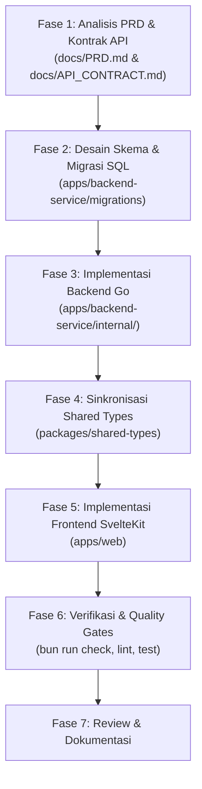

# Panduan Pengembangan Fitur (Feature Development Workflow)

Dokumen ini adalah **Standard Operating Procedure (SOP)** yang wajib dijadikan acuan setiap kali pengembang (atau AI assistant) akan mengimplementasikan atau memperbarui fitur di dalam repositori ini.

---

## 1. Siklus Hidup Pengerjaan Fitur (Workflow Overview)



---

## 2. Langkah Demi Langkah (Step-by-Step Guide)

### Fase 1: Analisis Kebutuhan & Desain Kontrak
Sebelum menulis kode:
1. **Identifikasi Kebutuhan:** Buka `docs/PRD.md`, cek ID Kebutuhan Fungsional (misal: `FR-020` Checkout) dan Aturan Bisnis terkait (misal: `BR-006` Backend calculation, `BR-007` Atomic deduction).
2. **Periksa Kontrak API:** Buka `docs/API_CONTRACT.md`, pastikan rincian endpoint, metode HTTP, format request body, query parameters, dan respon JSON sudah disepakati. Jika ada field baru, perbarui `docs/API_CONTRACT.md` terlebih dahulu.

---

### Fase 2: Skema Database & Migrasi (Jika Ada Perubahan DB)
Lokasi: `apps/backend-service/migrations/`

1. **Buat File Migrasi:**
   Gunakan format penomoran sekuensial atau timestamp:
   - `00000X_nama_fitur.up.sql` (untuk eksekusi pembuatan/perubahan)
   - `00000X_nama_fitur.down.sql` (untuk rollback)
2. **Kaidah Penulisan SQL:**
   - Gunakan tipe data `UUID` untuk primary key (`DEFAULT gen_random_uuid()`).
   - Gunakan `TIMESTAMPTZ` untuk kolom waktu dengan default `NOW()`.
   - Berikan foreign key constraints yang jelas (`ON DELETE RESTRICT` atau `CASCADE`).
   - Tambahkan index pada kolom yang sering dicari atau difilter (misal: `seller_id`, `status`, `created_at`).
   - Sertakan check constraints untuk integritas nilai (misal: `CHECK (price >= 0)`, `CHECK (quantity > 0)`).

---

### Fase 3: Implementasi Backend Go
Lokasi: `apps/backend-service/internal/<nama_modul>/`

Backend menggunakan arsitektur **Modular Monolith**. Setiap modul fitur memiliki struktur lapisan seragam:

```
apps/backend-service/internal/<module>/
├── model.go        # Entity domain / representasi tabel database
├── dto.go          # Data Transfer Object (Request & Response struct)
├── repository.go   # Lapisan query database PostgreSQL
├── service.go      # Lapisan logika bisnis & transaksi ACID
└── handler.go      # Lapisan HTTP (decode JSON, routing, status code)
```

#### Aturan Penerapan Setiap Layer:
1. **`model.go`:**
   Mendefinisikan struct representasi domain dan tag database.
2. **`dto.go`:**
   Mendefinisikan payload input (`CreateXRequest`, `UpdateXRequest`) dan payload respon (`XResponse`). Tambahkan tag `json:"..."`.
3. **`repository.go`:**
   - Gunakan parameter binding (`$1, $2, ...`) untuk mencegah SQL Injection.
   - Selalu teruskan `context.Context` ke operasi query/exec (`QueryRowContext`, `ExecContext`).
   - Jika operasi merupakan bagian dari transaksi, sediakan method yang menerima `*sql.Tx` atau buat runner transaksi.
4. **`service.go`:**
   - Tempat seluruh aturan bisnis diuji (validasi stok, verifikasi kepemilikan seller, transisi status).
   - Jangan pernah menyertakan dependensi `net/http` di layer ini.
   - Wajib menggunakan transaksi database jika operasi memodifikasi lebih dari satu tabel atau membutuhkan pembacaan stok dengan penguncian (`FOR UPDATE`).
5. **`handler.go`:**
   - Parse URL params, query params, atau JSON body.
   - Panggil Service.
   - Gunakan shared response helper untuk respon standar:
     - Sukses: `shared/response.Success(w, statusCode, message, data, meta)`
     - Error: `shared/response.Error(w, statusCode, errorCode, message, details)`
6. **Registrasi Router & Middleware:**
   - Daftarkan endpoint ke router HTTP di `cmd/server/main.go` atau router modul terkait.
   - Pasang middleware pengaman:
     - `middleware.RequireAuth`: Memastikan token JWT valid.
     - `middleware.RequireRole("seller")` atau `middleware.RequireRole("buyer")`.

---

### Fase 4: Sinkronisasi Shared Types
Lokasi: `packages/shared-types/src/index.ts`

Setiap ada penambahan DTO atau entitas data baru di backend, sinkronkan ke paket TypeScript bersama agar frontend tetap *type-safe*:

1. Buka `packages/shared-types/src/index.ts`.
2. Ekspor antarmuka TypeScript baru (misal: `OrderItem`, `CreateOrderPayload`, `OrderSummary`).
3. Jalankan pengecekan tipe:
   ```bash
   bun run check
   ```

---

### Fase 5: Implementasi Frontend SvelteKit
Lokasi: `apps/web/`

Frontend memanfaatkan fitur modern **SvelteKit** dan **Svelte 5 Runes**.

1. **API Client Layer (`src/lib/api/<feature>.ts`):**
   - Buat fungsi pembungkus `fetch` yang memanggil endpoint backend.
   - Manfaatkan tipe dari `@ecommerce/shared-types`:
   ```ts
   import type { ApiResponse, Product } from '@ecommerce/shared-types';

   export async function getProduct(id: string): Promise<Product> {
     const res = await fetch(`/api/v1/products/${id}`);
     const json: ApiResponse<Product> = await res.json();
     if (!res.ok) throw new Error(json.message || 'Failed to fetch product');
     return json.data!;
   }
   ```
2. **Reactivity & State Management (Svelte 5):**
   - Gunakan runes modern: `$state()`, `$derived()`, `$effect()`, dan `$props()`.
   - Hindari pola lama `let count = 0; $: double = count * 2`.
3. **Komponen UI (`src/lib/components/<feature>/`):**
   - Bangun komponen UI terisolasi dengan Tailwind CSS v4.
   - Buat Storybook story (`.stories.svelte`) jika komponen merupakan atom/molekul visual penting.
4. **Halaman & Rute (`src/routes/...`):**
   - Kelompokkan rute berdasarkan hak akses:
     - `(auth)` untuk login/register
     - `(buyer)` untuk keranjang, checkout, pesanan
     - `(seller)` untuk dashboard dan manajemen inventaris
   - Manfaatkan `load` function SvelteKit (`+page.ts` / `+page.server.ts`) untuk *data fetching* awal.
   - Tampilkan status *loading* dan *error feedback* yang ramah pengguna.

---

### Fase 6: Verifikasi & Quality Gates

Sebelum menyelesaikan pekerjaan, seluruh verifikasi otomatis wajib berstatus **PASS**:

```bash
# 1. Jalankan pemeriksaan tipe di seluruh workspace (Svelte & TypeScript)
bun run check

# 2. Jalankan linter dan formatter
bun run lint

# 3. Jalankan pengujian backend Go
cd apps/backend-service && go test -v ./... && cd ../..

# 4. Jalankan pengujian frontend (unit test Vitest & e2e Playwright)
bun run test
```

---

### Fase 7: Dokumentasi & Changelog

1. Jika ada endpoint baru atau perubahan skema payload, pastikan `docs/API_CONTRACT.md` diperbarui.
2. Jika ada tabel atau kolom baru, pastikan `docs/DATABASE_ERD.md` dan diagram Mermaid diperbarui.
3. Gunakan format Conventional Commits saat commit kode:
   - `feat(order): implement atomic checkout transaction`
   - `fix(product): prevent seller from modifying other seller items`
   - `docs(api): document cancel order endpoint`

---

## 3. Checklist Cepat untuk Developer / Agent

Salin checklist ini setiap kali memulai penambahan fitur:

- [ ] **Spesifikasi:** Sudah membaca `docs/PRD.md` dan `docs/API_CONTRACT.md`.
- [ ] **Database:** Migrasi SQL `.up.sql` dan `.down.sql` sudah siap dan diuji.
- [ ] **Backend Go:**
  - [ ] `model.go` & `dto.go` terdefinisi.
  - [ ] `repository.go` menggunakan parameterized query.
  - [ ] `service.go` memuat aturan bisnis & transaksi atomik jika diperlukan.
  - [ ] `handler.go` menggunakan response helper standar.
  - [ ] Middleware Auth / RBAC sudah dipasang.
- [ ] **Shared Types:** Tipe data di `packages/shared-types` sudah sinkron.
- [ ] **Frontend SvelteKit:**
  - [ ] API client terpasang dan menangani error.
  - [ ] UI menggunakan Svelte 5 Runes dan Tailwind v4.
  - [ ] Route guard membatasi akses sesuai role pengguna.
- [ ] **Quality Gates:**
  - [ ] `bun run check` sukses tanpa error.
  - [ ] `bun run lint` sukses tanpa error.
  - [ ] `go test ./...` lulus.

