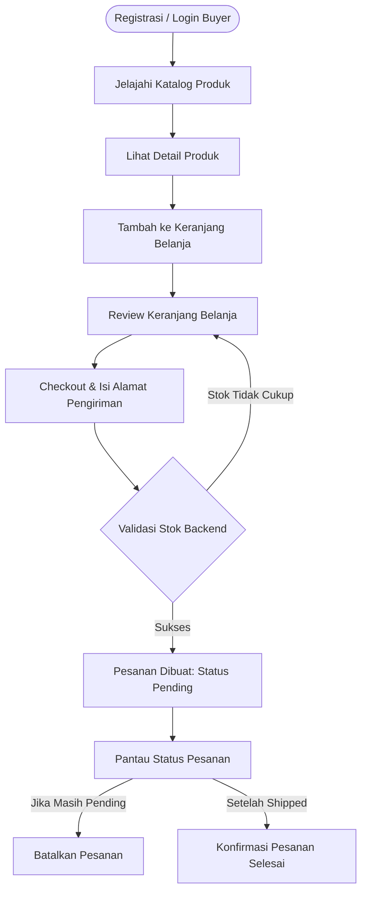
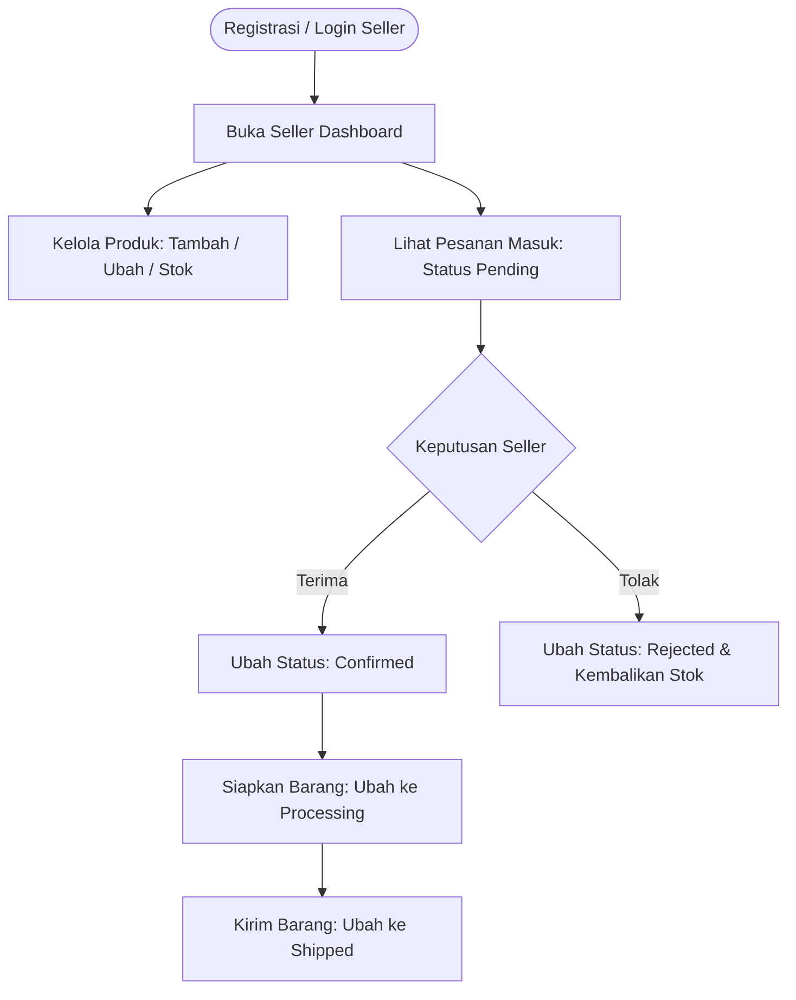
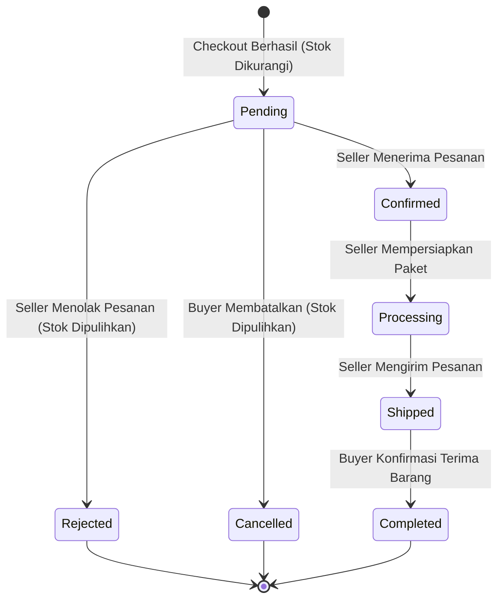

# Product Requirements Document (PRD)

## Simple E-Commerce Platform
**Learning Project — Minimum Viable Product (MVP)**  
**Version:** 1.0.0  
**Stack:** SvelteKit (Svelte 5, Tailwind CSS v4) · Golang (net/http, Modular Monolith) · PostgreSQL  
**Repository Architecture:** Turborepo + Bun Monorepo

---

## 1. Project Overview

### 1.1 Latar Belakang
Proyek ini merupakan aplikasi e-commerce sederhana yang dikembangkan sebagai media pembelajaran komprehensif dalam membangun aplikasi web modern berbasis *client-server architecture* dalam struktur *monorepo*.

Aplikasi memfasilitasi dua peran pengguna:
- **Penjual (Seller):** Mengelola katalog produk dan memproses pesanan masuk.
- **Pembeli (Buyer):** Menjelajahi katalog produk, menambahkan barang ke keranjang belanja, melakukan checkout dengan alamat pengiriman, dan memantau status pesanan.

Pengembangan difokuskan pada penguasaan integrasi antara frontend berbasis SvelteKit (Svelte 5) dan backend REST API berbasis Go (Golang) menggunakan database relasional PostgreSQL.

### 1.2 Tujuan Produk
1. **Frontend Mastery:** Mempelajari pengembangan frontend modern menggunakan SvelteKit, Svelte 5 (Runes), TypeScript, dan Tailwind CSS v4.
2. **Backend Engineering:** Mempelajari pembuatan REST API idiomatik dengan Go, arsitektur *modular monolith*, penanganan *concurrency*, dan integritas transaksi database (ACID).
3. **End-to-End Integration:** Memahami komunikasi data tipe aman (*type-safe*) antara frontend dan backend dengan bantuan paket `@ecommerce/shared-types`.
4. **Auth & RBAC:** Mengimplementasikan autentikasi stateless (JWT token + refresh token cookie) serta otorisasi berbasis peran (*Role-Based Access Control*).
5. **E-Commerce Core Flow:** Memahami siklus hidup transaksi nyata: pemilihan produk -> penguncian stok -> pembuatan pesanan -> transisi status pesanan.
6. **Relational Data Modeling:** Mendesain skema PostgreSQL yang normal, konsisten, menggunakan snapshot histori transaksi, dan menerapkan *soft-delete*.

### 1.3 Target Pengguna
1. **Pembeli (Buyer):** Pengguna yang mencari, memilih, membeli produk, dan melacak status pesanan.
2. **Penjual (Seller):** Pengguna yang mengelola produk miliknya dan memproses pesanan yang masuk dari pembeli.

---

## 2. Scope Produk

### 2.1 Fitur yang Termasuk MVP

| Modul | Pembeli (Buyer) | Penjual (Seller) |
|---|:---:|:---:|
| Registrasi akun (pilih role `buyer` / `seller`) | ✓ | ✓ |
| Login dan logout | ✓ | ✓ |
| Melihat profil pengguna aktif (`/auth/me`) | ✓ | ✓ |
| Mengubah profil | ✓ | ✓ |
| Melihat katalog produk aktif | ✓ | ✓ |
| Melihat detail produk | ✓ | ✓ |
| Pencarian produk (berdasarkan nama) | ✓ | ✓ |
| Mengelola produk sendiri (Create, Read, Update, Soft-delete) | - | ✓ |
| Memperbarui stok produk | - | ✓ |
| Keranjang belanja (Tambah, Ubah kuantitas, Hapus item) | ✓ | - |
| Checkout pesanan (Validasi stok, input alamat pengiriman) | ✓ | - |
| Riwayat dan detail pesanan | ✓ | ✓ (hanya pesanan miliknya) |
| Pemrosesan status pesanan (Konfirmasi, Proses, Kirim, Tolak) | - | ✓ |
| Konfirmasi pesanan selesai / Pembatalan pesanan pending | ✓ | - |

> **Catatan Scope Khusus MVP:**  
> Untuk menjaga kompleksitas tetap terukur dalam fase pembelajaran, **satu pesanan (checkout) hanya boleh berisi produk dari satu penjual (single-seller per checkout)**. Keranjang belanja membatasi atau memperingatkan pembeli agar item berasal dari seller yang sama saat checkout.

### 2.2 Fitur di Luar Scope MVP
Fitur-fitur berikut ditangguhkan untuk iterasi lanjutan:
- Integrasi Payment Gateway pihak ketiga (Midtrans, Xendit, Stripe). Pembayaran disimulasikan otomatis / manual transfer.
- Integrasi kurir & ongkos kirim otomatis (RajaOngkir, dsb).
- Multi-seller checkout split dalam satu pesanan.
- Sistem kupon, diskon, dan promo.
- Rating, ulasan, dan komentar produk.
- Chat langsung buyer-seller.
- Wishlist / Favorit produk.
- Notifikasi real-time via WebSocket / Web Push.
- Multi-bahasa (i18n).

---

## 3. Functional Requirements

### 3.1 Authentication & Account Management
| ID | Aktor | Functional Requirement |
|---|---|---|
| **FR-001** | Buyer, Seller | Pengguna dapat melakukan registrasi akun baru dengan menentukan nama, email, password, dan role (`buyer` / `seller`). |
| **FR-002** | Buyer, Seller | Pengguna dapat login menggunakan email dan password yang valid untuk menerima access token JWT dan refresh token. |
| **FR-003** | Buyer, Seller | Pengguna dapat logout untuk mencabut refresh token dan menghapus sesi. |
| **FR-004** | Buyer, Seller | Sistem membedakan hak akses endpoint dan halaman berdasarkan role pengguna (RBAC). |
| **FR-005** | Buyer, Seller | Pengguna dapat melihat informasi profil akun miliknya (`GET /api/v1/auth/me`). |
| **FR-006** | Buyer, Seller | Pengguna dapat memperbarui informasi nama atau password profil. |

### 3.2 Product Management
| ID | Aktor | Functional Requirement |
|---|---|---|
| **FR-007** | Buyer, Seller | Sistem menampilkan katalog produk publik yang aktif dan belum dihapus (*paginated*). |
| **FR-008** | Buyer, Seller | Sistem menampilkan detail lengkap produk berdasarkan ID. |
| **FR-009** | Buyer, Seller | Sistem menyediakan pencarian produk berdasarkan nama (*case-insensitive*). |
| **FR-010** | Seller | Seller dapat menambahkan produk baru (nama, deskripsi, harga, stok, URL gambar). |
| **FR-011** | Seller | Seller dapat memperbarui informasi produk miliknya sendiri. |
| **FR-012** | Seller | Seller dapat menghapus produk miliknya secara *soft-delete* (menjaga integritas histori transaksi). |
| **FR-013** | Seller | Seller dapat melihat daftar seluruh produk miliknya di dashboard seller. |
| **FR-014** | Seller | Seller dapat memperbarui jumlah stok produk miliknya secara cepat. |

### 3.3 Shopping Cart
| ID | Aktor | Functional Requirement |
|---|---|---|
| **FR-015** | Buyer | Buyer dapat memasukkan produk ke keranjang belanja dengan kuantitas tertentu. |
| **FR-016** | Buyer | Buyer dapat melihat daftar item di keranjang beserta kalkulasi subtotal dan total harga terkini. |
| **FR-017** | Buyer | Buyer dapat mengubah kuantitas item di keranjang (harus $\le$ stok produk tersedia). |
| **FR-018** | Buyer | Buyer dapat menghapus produk tertentu dari keranjang. |
| **FR-019** | Buyer | Buyer dapat mengosongkan seluruh isi keranjang (*clear cart*). |

### 3.4 Order & Checkout
| ID | Aktor | Functional Requirement |
|---|---|---|
| **FR-020** | Buyer | Buyer dapat melakukan checkout dari isi keranjang belanja. |
| **FR-021** | Buyer | Buyer wajib mengisi informasi alamat pengiriman terstruktur (penerima, telepon, alamat, kota, kode pos). |
| **FR-022** | Buyer | Sistem memvalidasi ketersediaan stok produk secara atomik (*row-level locking*) sebelum pesanan dibuat. |
| **FR-023** | Buyer | Sistem membuat record pesanan dan menyalin snapshot harga dan nama produk ke `order_items`. |
| **FR-024** | Buyer | Sistem mengurangi stok produk sejumlah kuantitas yang dipesan dan mengosongkan item keranjang. |
| **FR-025** | Buyer | Buyer dapat melihat detail pesanan dan riwayat seluruh pesanan miliknya. |
| **FR-026** | Buyer | Buyer dapat membatalkan pesanan miliknya selama status masih `pending`, yang akan mengembalikan stok produk. |

### 3.5 Order Management
| ID | Aktor | Functional Requirement |
|---|---|---|
| **FR-027** | Seller | Seller dapat melihat daftar pesanan yang masuk khusus untuk produk miliknya. |
| **FR-028** | Seller | Seller dapat melihat rincian detail pesanan pembeli beserta alamat pengiriman. |
| **FR-029** | Seller | Seller dapat menerima pesanan (`pending` $\rightarrow$ `confirmed`). |
| **FR-030** | Seller | Seller dapat menolak pesanan (`pending` $\rightarrow$ `rejected`), yang otomatis mengembalikan stok produk. |
| **FR-031** | Seller | Seller dapat memperbarui status pesanan menjadi diproses (`confirmed` $\rightarrow$ `processing`). |
| **FR-032** | Seller | Seller dapat memperbarui status pesanan menjadi dikirim (`processing` $\rightarrow$ `shipped`). |
| **FR-033** | Buyer | Buyer dapat mengonfirmasi pesanan telah diterima (`shipped` $\rightarrow$ `completed`). |

---

## 4. Business Process & Order Lifecycle

### 4.1 Alur Pembeli (Buyer Flow)

### 4.2 Alur Penjual (Seller Flow)

### 4.3 Order State Machine

---

## 5. Non-Functional Requirements (NFR)

| ID | Kategori | Spesifikasi & Tolok Ukur |
|---|---|---|
| **NFR-001** | Performance | Respons endpoint backend rata-rata $\le$ 200 ms pada lingkungan lokal/staging; maksimal 2 detik pada query katalog ber-filter. |
| **NFR-002** | Security (Passwords) | Password disimpan menggunakan algoritma hashing modern (Argon2id atau Bcrypt work factor $\ge$ 10). Plaintext dilarang keras. |
| **NFR-003** | Security (Tokens) | Access token JWT berumur pendek (15 menit). Refresh token disimpan dengan hashing di database dan dikirim via cookie `HttpOnly`, `Secure`, `SameSite=Strict`. |
| **NFR-004** | Authorization | Setiap endpoint terproteksi wajib divalidasi oleh middleware token dan middleware role. Seller tidak boleh memodifikasi data seller lain. |
| **NFR-005** | Concurrency & Integrity | Proses checkout dan perubahan stok wajib menggunakan PostgreSQL ACID Transaction dengan row-locking (`FOR UPDATE`) untuk mencegah *race condition* dan *overselling*. |
| **NFR-006** | Data Consistency | Tabel `order_items` wajib menyimpan salinan statis (*snapshot*) harga dan nama produk saat checkout, sehingga perubahan harga katalog tidak merusak histori transaksi. |
| **NFR-007** | Maintainability | Proyek disusun dalam arsitektur Monorepo (Turborepo + Bun) dengan pemisahan aplikasi (`apps/web`, `apps/backend-service`) dan pustaka kontrak bersama (`packages/shared-types`). |
| **NFR-008** | Code Quality | Kode lolos verifikasi `bun run check`, `bun run lint`, serta unit test tanpa peringatan error. |

---

## 6. Business Rules (Aturan Bisnis Kunci)

| ID | Kode Aturan | Deskripsi |
|---|---|---|
| **BR-001** | `ROLE_IMMUTABLE` | Setiap akun hanya memiliki satu role (`buyer` atau `seller`) yang ditentukan saat registrasi dan tidak dapat diubah sembarangan. |
| **BR-002** | `UNIQUE_EMAIL` | Email pengguna harus unik dalam sistem (*case-insensitive comparison*). |
| **BR-003** | `SELLER_OWNERSHIP` | Seller hanya berhak melihat, mengubah, dan menghapus produk yang memiliki `seller_id` sesuai identitas tokennya. |
| **BR-004** | `ZERO_STOCK_GUARD` | Produk dengan stok 0 tetap dapat ditampilkan di katalog (status *Habis*), namun tidak dapat ditambahkan ke keranjang atau di-checkout. |
| **BR-005** | `PURCHASE_QTY_LIMIT` | Kuantitas barang yang dipesan tidak boleh melebihi stok yang tersedia saat transaksi checkout dieksekusi. |
| **BR-006** | `BACKEND_CALCULATION` | Nilai `subtotal`, diskon, dan `total_amount` selalu dihitung di backend berdasarkan harga database aktif. Nilai kalkulasi dari frontend diabaikan demi keamanan. |
| **BR-007** | `ATOMIC_DEDUCTION` | Pengurangan stok produk dilakukan di dalam transaksi database yang sama dengan pembuatan pesanan. |
| **BR-008** | `STOCK_RESTORATION` | Stok hanya dikembalikan tepat satu kali jika pesanan berstatus `pending` beralih ke `cancelled` (oleh buyer) atau `rejected` (oleh seller). |
| **BR-009** | `PRICE_SNAPSHOT` | Harga satuan (`unit_price`) dan nama produk pada `order_items` bersifat statis (*snapshot* transaksi) dan kebal terhadap revisi harga katalog di masa depan. |
| **BR-010** | `SINGLE_SELLER_ORDER` | Satu transaksi pesanan hanya boleh memuat produk dari satu seller. Jika buyer memiliki barang dari beragam seller, keranjang memisahkan proses checkout per seller. |
| **BR-011** | `ORDER_ACCESS_CONTROL` | Seller hanya dapat membaca dan memproses pesanan yang ditujukan untuk tokonya (`seller_id`). Buyer hanya dapat membaca pesanan miliknya (`buyer_id`). |
| **BR-012** | `TERMINAL_STATE` | Status pesanan `completed`, `cancelled`, dan `rejected` adalah status terminal. Transisi status dari status-status ini ditolak oleh sistem. |

---

## 7. MVP Acceptance Criteria

Proyek dinyatakan berhasil memenuhi kriteria MVP apabila:

1. **Authentication & RBAC:**
   - Pengguna dapat mendaftar sebagai Buyer maupun Seller.
   - Login menghasilkan JWT token valid dan refresh cookie aman.
   - Endpoint terproteksi menolak akses tanpa token (401) atau role tidak sesuai (403).
2. **Katalog & Manajemen Produk:**
   - Seller dapat membuat, melihat, mengedit, dan menghapus (*soft-delete*) produk.
   - Buyer dapat mencari dan memfilter produk aktif di katalog.
3. **Keranjang Belanja:**
   - Buyer dapat menambah, mengedit kuantitas, dan menghapus item keranjang belanja.
   - Total harga keranjang terhitung akurat sesuai harga katalog terkini.
4. **Checkout & Integritas Transaksi:**
   - Checkout sukses membuat pesanan, mencatat `order_items` snapshot, mengurangi stok, dan mengosongkan keranjang.
   - Pengujian dua pembeli membeli stok terakhir secara bersamaan (*concurrent checkout*) ditangani dengan aman tanpa *negative stock*.
   - Pembatalan atau penolakan pesanan memulihkan stok kembali secara otomatis.
5. **Manajemen Pesanan:**
   - Seller dapat melihat pesanan masuk dan mengubah status secara berurutan (`pending` $\rightarrow$ `confirmed` $\rightarrow$ `processing` $\rightarrow$ `shipped`).
   - Buyer dapat mengonfirmasi penerimaan barang (`shipped` $\rightarrow$ `completed`).
6. **Integrasi Monorepo:**
   - Aplikasi SvelteKit (`apps/web`) dapat berkomunikasi secara *type-safe* dengan backend Go (`apps/backend-service`).
   - Tipe data TypeScript pada `packages/shared-types` sinkron dengan DTO backend Go.

---

## 8. Development Roadmap & Milestones

| Milestone | Fase | Aktivitas Utama | Output |
|:---:|---|---|---|
| **M1** | **Foundation & Setup** | Setup Turborepo, Bun, Go workspace, PostgreSQL container, dan migrasi DDL awal. | Repositori siap jalan via `bun run dev`. |
| **M2** | **Auth & RBAC** | Implementasi Register, Login, JWT access token, Refresh token, Middleware RBAC di Go & SvelteKit hooks. | Autentikasi end-to-end berfungsi. |
| **M3** | **Product Management** | CRUD Produk Seller, Soft delete, Endpoint katalog publik dengan paginasi dan pencarian. | Katalog produk tampil di frontend. |
| **M4** | **Cart & Checkout** | Modul keranjang belanja buyer, transaksi checkout atomik di Go (`BEGIN...COMMIT`), penguncian stok. | Checkout berhasil dan memotong stok. |
| **M5** | **Order Processing** | State machine pesanan, seller order dashboard, buyer order history, pembatalan & pemulihan stok. | Siklus pesanan lengkap dari checkout hingga selesai. |
| **M6** | **Quality & Polish** | Unit tests, contract test API, Playwright E2E basic flow, Storybook component catalog, dan dokumentasi final. | Monorepo siap didemokan / di-deploy. |

