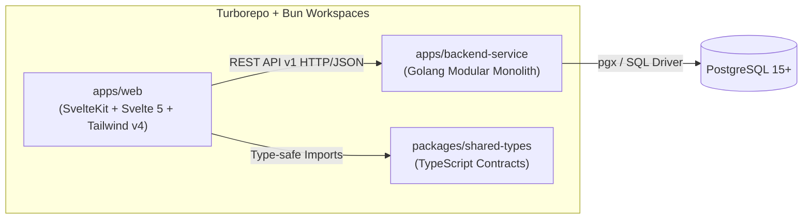

# Dokumentasi Proyek — Simple E-Commerce Platform

Selamat datang di portal dokumentasi resmi proyek **Simple E-Commerce Platform**. Repositori ini dikembangkan sebagai media pembelajaran komprehensif full-stack application dalam arsitektur monorepo modern menggunakan **Turborepo**, **Bun**, **SvelteKit (Svelte 5)**, **Golang (Modular Monolith)**, dan **PostgreSQL**.

---

## 📚 Daftar Dokumen & Panduan

Folder `docs/` ini memuat dokumen spesifikasi dan pedoman teknis yang terorganisasi sebagai berikut:

| Dokumen | Deskripsi | Target Pembaca |
|---|---|---|
| [**PRD.md**](./PRD.md) | **Product Requirements Document**<br/>Memuat visi produk, target aktor (Buyer & Seller), ruang lingkup MVP, kebutuhan fungsional (FR-001 s/d FR-033), non-functional requirements, alur proses bisnis, dan aturan bisnis utama (BR-001 s/d BR-012). | Product Owner, Pengembang, QA |
| [**DATABASE_ERD.md**](./DATABASE_ERD.md) | **Database Architecture & ERD**<br/>Menjelaskan perancangan database PostgreSQL 15+, diagram relasi entitas (Mermaid ERD), spesifikasi 7 tabel utama, mekanisme snapshot harga pada `order_items`, file DDL migrasi SQL, strategi indeks, dan atomisitas transaksi checkout (`FOR UPDATE`). | Backend Engineer, DBA |
| [**API_CONTRACT.md**](./API_CONTRACT.md) | **REST API v1 Specification & Contract**<br/>Dokumentasi lengkap seluruh endpoint REST API (`/api/v1/*`), otorisasi matriks (Public, Buyer, Seller), skema request & response JSON, format penanganan error standar, dan kode status HTTP. | Frontend & Backend Engineer |
| [**ARCHITECTURE.md**](./ARCHITECTURE.md) | **System Architecture & Technical Design**<br/>Rancangan arsitektur sistem end-to-end, pemisahan layer pada arsitektur Modular Monolith Go, struktur routing dan runes pada SvelteKit, arsitektur keamanan (Argon2id, JWT, HttpOnly cookies), dan konfigurasi Docker Compose. | Software Architect, Engineer |
| [**DESIGN.md**](../DESIGN.md) | **Semantic Design System & UI Specifications**<br/>Spesifikasi visual design system, palet warna, tipografi, styling komponen (Button, Card, Input, Badges), aturan Anti-Slop, dan token Tailwind CSS v4. | UI/UX Designer, Frontend Engineer |
| [**FEATURE_DEVELOPMENT_GUIDE.md**](./FEATURE_DEVELOPMENT_GUIDE.md) | **Panduan Pengerjaan Fitur (Developer SOP)**<br/>Panduan operasional langkah demi langkah bagi developer atau AI agent ketika akan menambahkan fitur baru (Alur: Analisis PRD $\rightarrow$ Migrasi SQL $\rightarrow$ Backend Go $\rightarrow$ Shared Types $\rightarrow$ Frontend SvelteKit $\rightarrow$ Quality Gates). | Semua Pengembang |

---

## 🛠️ Ringkasan Tech Stack Repositori



- **Monorepo Tools:** [Turborepo](https://turbo.build/repo), [Bun](https://bun.sh)
- **Frontend App:** [SvelteKit](https://kit.svelte.dev) dengan **Svelte 5** (Runes), [Tailwind CSS v4](https://tailwindcss.com), [Storybook](https://storybook.js.org), Vitest, Playwright.
- **Backend Service:** [Golang](https://go.dev) (Go 1.26), standard library `net/http` / modular layout (`cmd/server`, `internal/`, `pkg/`, `migrations/`).
- **Shared Types:** TypeScript shared interfaces (`@ecommerce/shared-types`).
- **Database:** PostgreSQL dengan container Docker Compose.

---

## 🚀 Perintah Cepat Pengembangan (Cheat Sheet)

```bash
# 1. Menjalankan seluruh aplikasi (Frontend + Backend)
bun run dev

# 2. Menjalankan hanya Frontend (http://localhost:5173)
bun run dev:web

# 3. Menjalankan hanya Backend (http://localhost:8000)
bun run dev:backend

# 4. Manajemen Database (Laravel-style Migrations)
bun run db:status     # Melihat status migrasi (Ran / Pending)
bun run db:migrate    # Menjalankan migrasi pending
bun run db:rollback   # Rollback migrasi terakhir
bun run db:fresh      # Reset database dan jalankan ulang semua migrasi + seeder
bun run db:seed       # Menjalankan seeder akun demo & sampel produk

# 5. Menjalankan pengecekan tipe statis di seluruh workspace
bun run check

# 6. Menjalankan linter dan formatter kode
bun run lint

# 7. Menjalankan pengujian (Unit & E2E)
bun run test
```

---

> 💡 **Tips Pengembang:**  
> Sebelum menambahkan atau memodifikasi fitur baru, selalu baca [**FEATURE_DEVELOPMENT_GUIDE.md**](./FEATURE_DEVELOPMENT_GUIDE.md) dan pastikan semua quality gates (`bun run check`, `bun run lint`, `bun run test`) lolos tanpa error.

